# APK-Recon

**Offline APK reconnaissance.** Point it at an Android package and get endpoints, deep links,
hardcoded secrets, SDKs, APK inventory, signing posture, a MASVS report, and an evidence-backed
risk score — all in a neutral, terminal-flavoured desktop UI. Everything runs locally; nothing
leaves the machine.

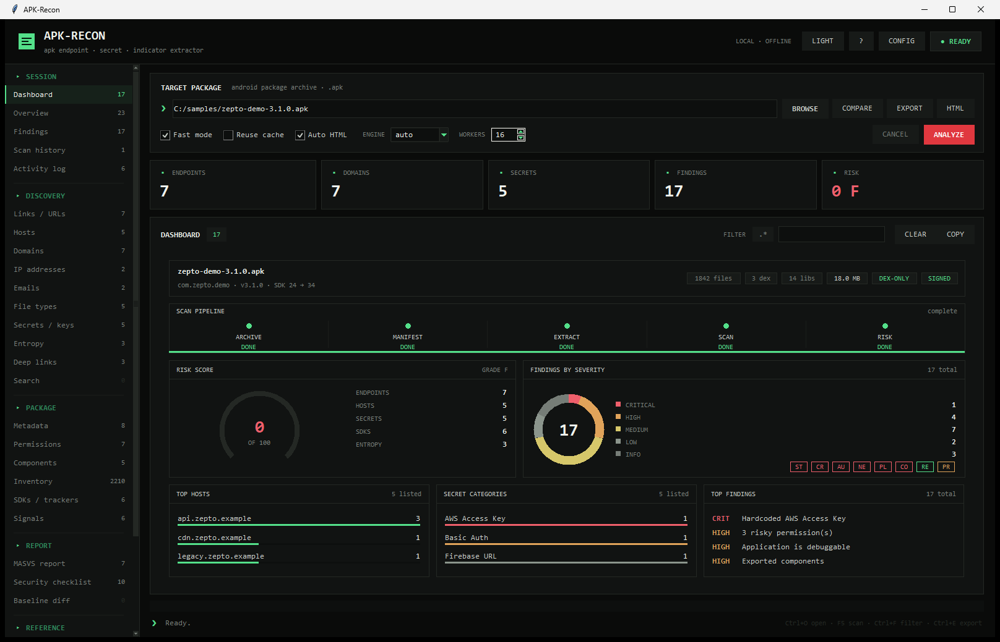

---

## Highlights

- **Scan setup chooser** — before each scan pick the extraction engine (auto / dex-only / jadx /
  apktool) with live availability detection, fast mode, cache reuse, deep strings and workers.
- **Adaptive, fast UI** — filter input is debounced, entropy can be switched off for speed, and
  every view re-renders from cached scan data.
- **Live scan pipeline** — ARCHIVE → MANIFEST → EXTRACT → SCAN → RISK, with spinner, percentage,
  ETA and a streaming activity log.
- **Scan history** — every run is recorded locally (engine, duration, counts, risk, grade) in a
  dedicated history view, so you can compare sessions over time.
- **Risk engine** — severity-rated findings (CRITICAL → INFO) with **evidence samples** (actual
  values, URLs, component names, cert details).
- **MASVS report** — all eight OWASP MASVS categories scored PASS / REVIEW / WARN from static
  evidence, with links to MASVS / MASTG.
- **Discovery surface** — URLs, hosts, domains, IPs, emails, extensions, secrets, entropy
  candidates, deep links, SDKs and platform signals.
- **APK internals** — manifest flags, exported components, signing schemes and certificate
  details; archive inventory (DEX, native ABIs, assets, resources, largest entries).
- **Baseline diff** — compare a new build against any previous JSON export: new/removed
  endpoints, permissions, components, SDKs, secrets and metadata changes.
- **Reports** — one-click **HTML** report that opens in your browser automatically after each
  scan (toggleable), plus Markdown / JSON / CSV / TXT exports.
- **Omni-search** — the filter box searches every view at once, with a regex toggle.

> All screenshots below were captured from a synthetic `zepto-demo-3.1.0.apk` dataset so the
> screens are fully populated. The UI is real; the findings are demo data.

---

## Download & install

APK-Recon is a self-contained Python/Tk application: no server, no build step, and **no required
pip packages**. Choose your platform below.

### 1. Get the files

If you received a `.zip`, extract it. Otherwise clone the repository:

```bash
git clone https://github.com/r4tnadeepbose/APK-Recon.git APK-Recon
cd APK-Recon
```

No Git installed? Use GitHub's **Code → Download ZIP** and extract it, or copy the folder you
already have. Keep the layout intact — `main.py` must sit next to the `apkrecon/` package:

```
APK-Recon/
├─ main.py
├─ apkrecon/
├─ docs/
└─ requirements.txt
```

To update a cloned copy later: `cd APK-Recon && git pull`.

### 2. Windows 10 / 11

1. **Install Python 3.10+** from [python.org](https://www.python.org/downloads/) and tick
   **"Add python.exe to PATH"**. Tkinter is included with the official installer. Verify:
   ```powershell
   py -3 --version
   ```
2. **Optional, recommended — androguard** (fast DEX engine, manifest and signing analysis):
   ```powershell
   py -3 -m pip install --upgrade androguard
   ```
3. **Optional decompilers** — APK-Recon auto-detects these locations, or set custom paths in
   **CONFIG**:
   - **jadx** — extract a release so `C:\jadx\bin\jadx.bat` exists.
   - **apktool** — place `apktool.jar` and `apktool.bat` in `C:\apktool`.
4. **Run** — double-click `main.py` in Explorer, or from a terminal:
   ```powershell
   cd C:\path\to\APK-Recon
   py -3 main.py
   ```

> If `python` is not on PATH, the `py -3` launcher above still works. The app is fully local — it
> opens no network sockets, so no firewall rules are needed.

### 3. Kali Linux

1. **Base packages** (Python 3 + Tk + Java for the decompilers):
   ```bash
   sudo apt update
   sudo apt install -y python3 python3-tk python3-venv openjdk-17-jre-headless
   ```
2. **Optional decompilers** — installs from the Kali repositories when available:
   ```bash
   sudo apt install -y jadx apktool
   ```
   If a package is missing in your release, download the upstream jadx release (extract to
   `/opt/jadx`) or the apktool wrapper, then set the path in **CONFIG**.
3. **Get the app and install androguard in a venv** (recommended):
   ```bash
   mkdir -p ~/tools && cd ~/tools
   git clone https://github.com/r4tnadeepbose/APK-Recon.git APK-Recon
   cd APK-Recon
   python3 -m venv .venv
   source .venv/bin/activate
   python -m pip install --upgrade pip
   python -m pip install --upgrade androguard
   ```
   Prefer not to use a venv? Kali marks Python as externally managed:
   ```bash
   python3 -m pip install --user androguard
   ```
   Only use `--break-system-packages` if you understand your distribution's policy.
4. **Run** as your desktop user — **not** with `sudo`, so Tk can open a window:
   ```bash
   chmod +x main.py
   ./main.py
   # or
   python3 main.py
   ```
   Works on Kali's XFCE desktop (X11/Wayland + XWayland). A headless SSH session needs an X server
   or VNC; plain TTY cannot show the GUI.

### Requirements at a glance

| Component | Needed for | Windows | Kali |
| --- | --- | --- | --- |
| Python 3.10+ with Tk | the app itself | python.org installer (Tk included) | `python3 python3-tk` |
| [androguard](https://github.com/androguard/androguard) | fast DEX engine, manifest & signing | `py -3 -m pip install androguard` | `pip install androguard` in a venv |
| [jadx](https://github.com/skylot/jadx) | Java/Kotlin decompilation | release zip → `C:\jadx` | `apt install jadx` |
| [apktool](https://apktool.org/) | smali / resource decompilation | `C:\apktool` | `apt install apktool` |

Without androguard the tool still runs the zip inventory, endpoint/secret extraction and reports
from decompiled output; APK metadata and signing data will simply be empty.

> On both platforms, `main.py` is the entry point. Settings (`apk_recon_settings.json`), history
> (`apk_recon_history.json`), reports (`reports/`) and the decompile cache (`decompiled_apk_temp/`)
> are written next to it. Nothing is uploaded; the app makes no network calls.

---

## First run

1. **BROWSE** is highlighted red. Pick an `.apk`.
2. Browse returns to normal and **ANALYZE** turns red. Click it.
3. **SCAN SETUP** opens: choose the engine (auto / dex-only / jadx / apktool — unavailable engines
   are marked), toggle fast mode, cache reuse and deep strings, set workers, then **START SCAN**.
   Uncheck "Don't show this again" if you prefer the direct path next time.
4. While scanning, ANALYZE switches to a pale red **ANALYZING…** state and the dashboard shows
   the pipeline live. **CANCEL** stops the run.
5. Review findings, then export or let the HTML report open automatically.

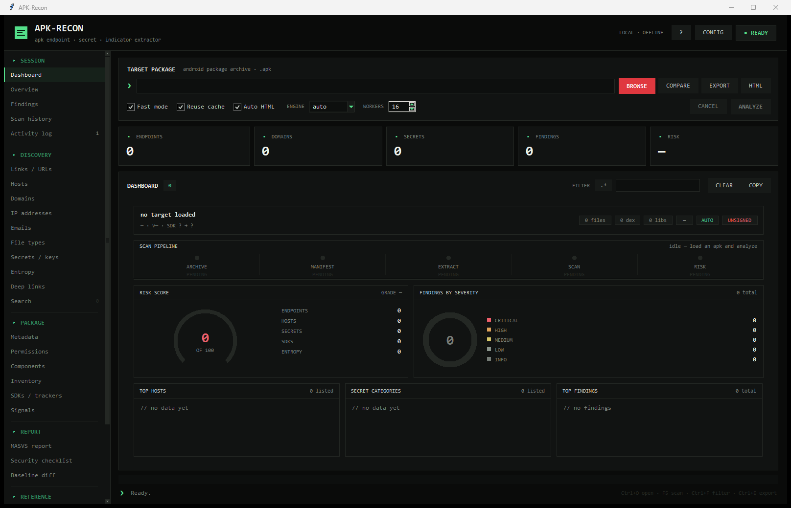

---

## Screens, one by one

### SESSION

#### Dashboard


The landing view. Charts are drawn directly on a Tk canvas — no plotting dependency.

- **Target strip** — APK name, package, version, SDK range, signature state, engine, size and
  file/DEX/library counts as compact chips.
- **Risk gauge** — score 0–100 with letter grade; the arc colour is green ≥ 75, amber ≥ 50, red
  below that.
- **Severity donut** — finding counts per severity, plus a row of MASVS status chips (ST CR AU NE
  PL CO RE PR) colour-coded PASS/REVIEW/WARN.
- **Top hosts / secret categories / top findings** — three live panels; the layout collapses to
  two columns on narrower windows.
- **Pipeline strip** — per-phase status with a rotating indicator on the active phase, progress
  fraction, counts and ETA (elapsed time extrapolated from work completed).
- Clicking any KPI card jumps to the matching view.

#### Overview
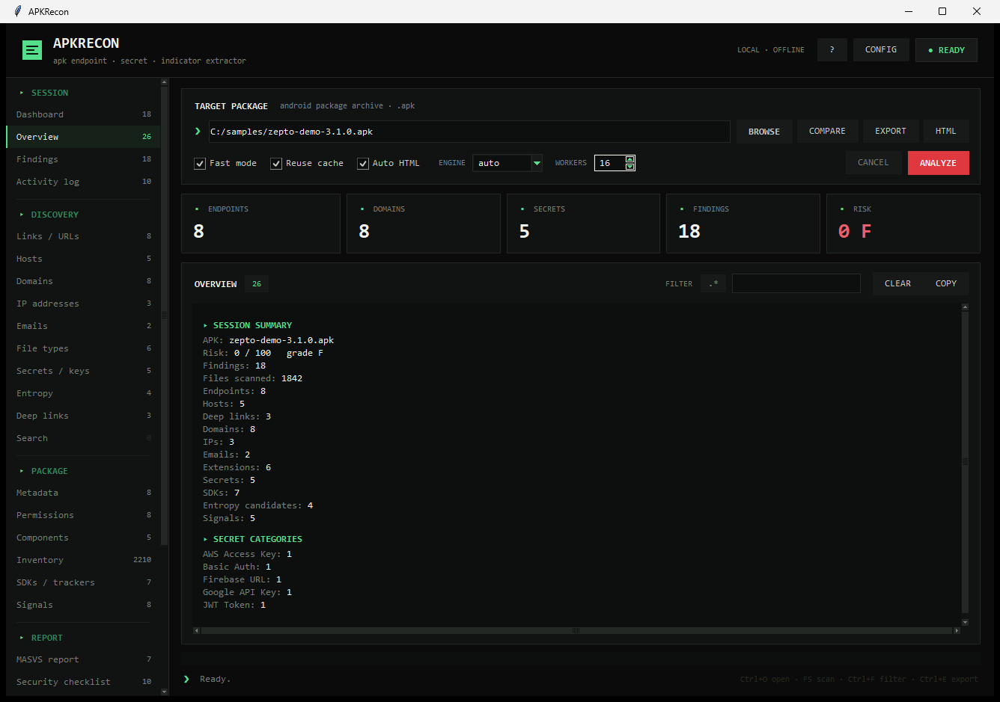

A flat text summary of the whole session: APK name, risk, finding counts, endpoints, hosts, deep
links, domains, IPs, emails, extensions, secrets, SDKs, entropy and per-category secret counts.

#### Findings
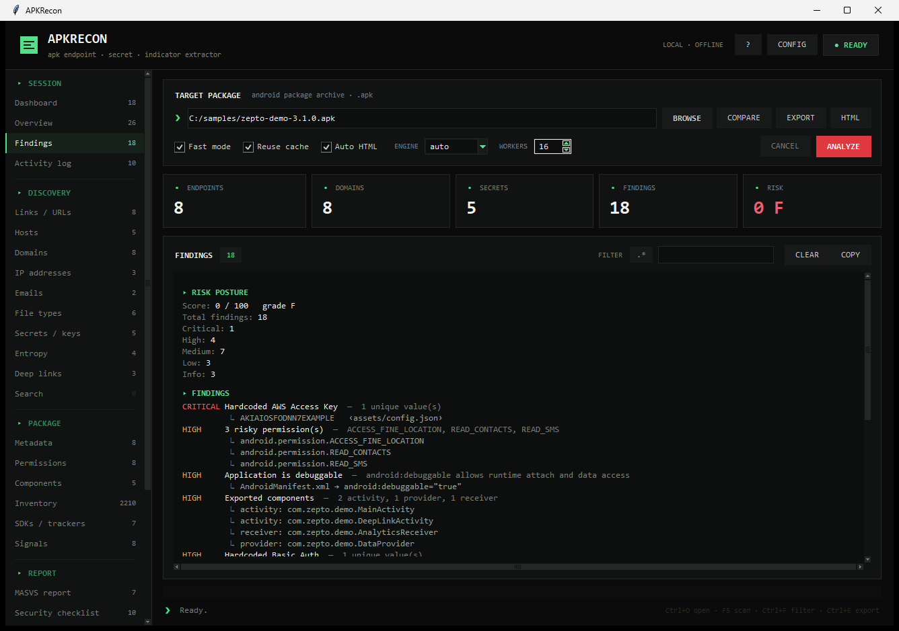

Every finding carries a severity badge, a one-line explanation and — for CRITICAL / HIGH / MEDIUM —
indented **evidence samples** prefixed with `↳`: the literal key value and its file, cleartext URLs,
exported component names, permission strings, manifest attributes, crypto markers or certificate
details. Double-click any line to copy it.

#### Activity log
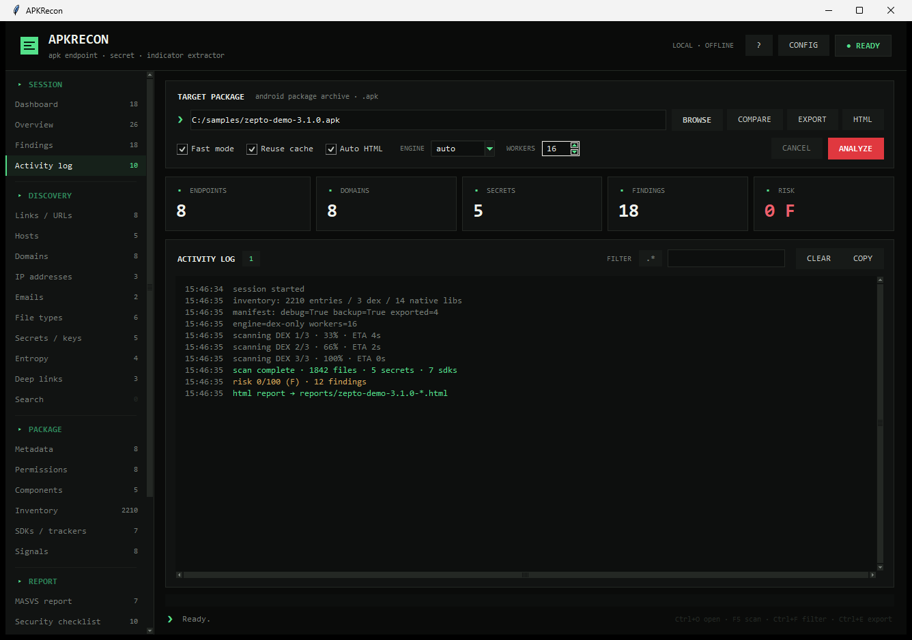

Timestamped session log: target load, inventory, manifest, engine choice, streamed jadx/apktool
output, scan failures, report generation. Capped at 1,500 lines so long sessions stay responsive.

#### Scan history
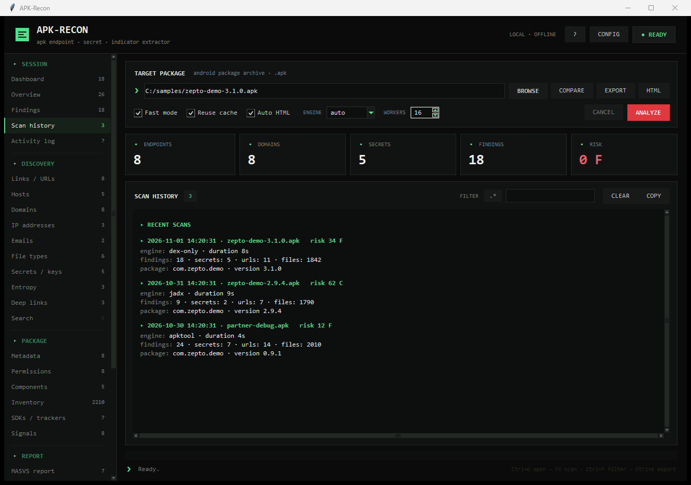

Every completed scan is recorded locally in `apk_recon_history.json`: timestamp, APK, package,
version, engine, duration, file/URL/secret counts, risk and grade (plus the report path when one
was generated). Newest first; cleared from CONFIG. The view is searchable like any other.

---

### DISCOVERY

#### Links / URLs
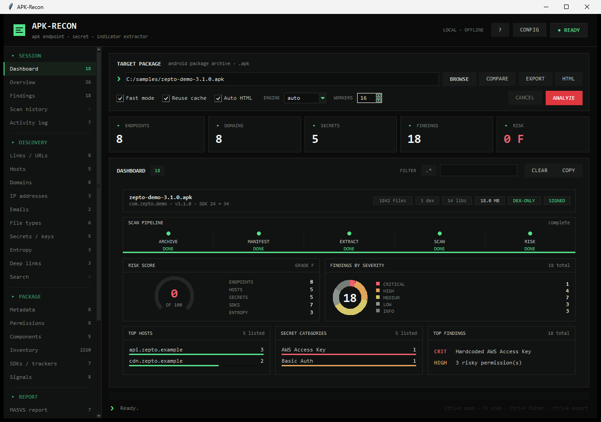

Every URL and URI matched by the catalog. HTTPS/safe schemes are tinted green, `http://` is amber.
Double-click to copy a single endpoint.

#### Hosts


The endpoint surface grouped and summarised:

- **URL hygiene** — cleartext count, IP-literal hosts, non-standard ports, punycode hosts.
- **Path prefixes** — first two path segments aggregated across endpoints (API shape at a glance).
- **Deep-link schemes** — custom scheme frequency.
- **Query parameters** — parameter names with reference counts.
- **Per host** — reference count, schemes, sample paths.

#### Domains
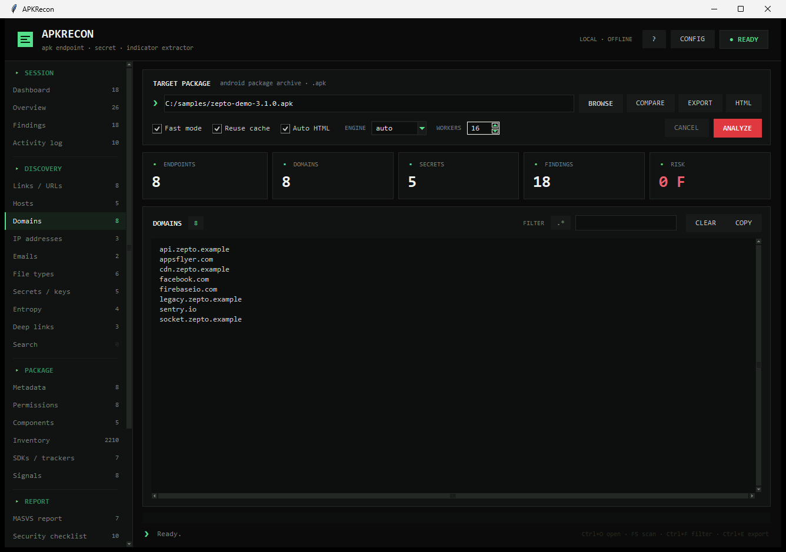

Domain-shaped strings found anywhere in the scan (not just URL hosts) — includes DEX string
tables, config files and resources.

#### IP addresses


IPv4 and IPv6 literals, useful for staging hosts and internal infrastructure leaks.

#### Emails
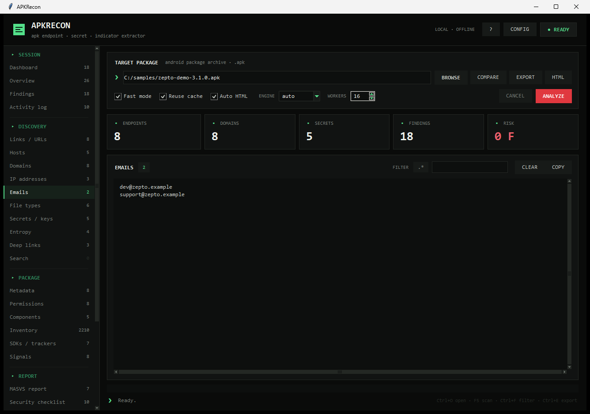

Embedded email addresses (contact leaks, developer comments, test accounts).

#### File types


Extension frequency from scanned content — a quick read on assets, archives, keys and configs
referenced by the app.

#### Secrets / keys


The full regex catalog output, grouped by category. Values keep their source file. Categories span
cloud, payments, auth tokens, chat webhooks, code hosting, wallets, Android-specific endpoints and
generic password/API-key heuristics.

#### Entropy
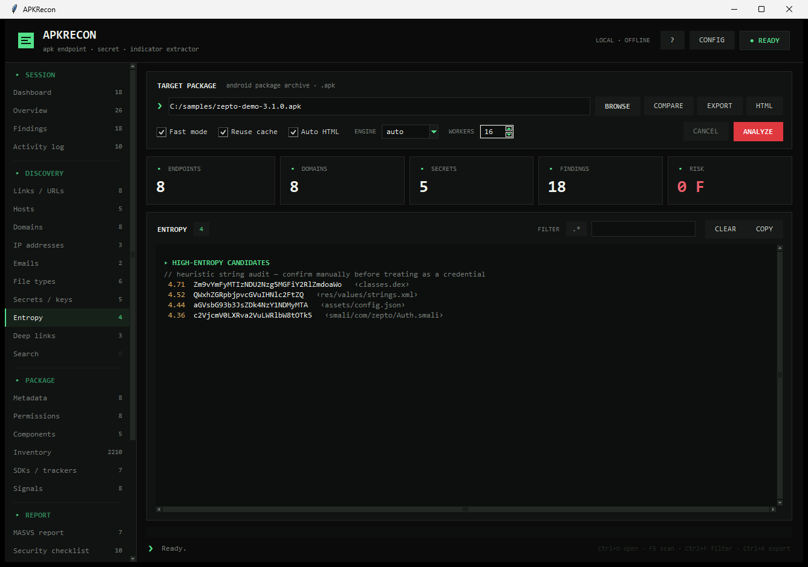

Shannon-entropy sweep for strings the regex catalog misses: candidate tokens ≥ 24 characters with
entropy ≥ 4.3, mixed letters and digits, at least 8 unique characters. Capped and labelled
*verify manually* — it is a lead generator, not a verdict.

#### Deep links
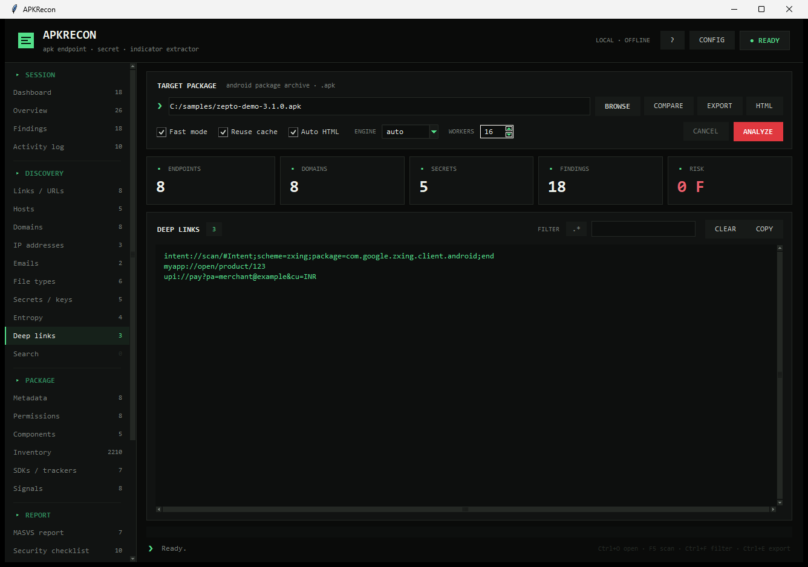

All non-HTTP schemes: app links, intents, payment URIs, market URIs. These feed the platform
attack-surface finding.

#### Search
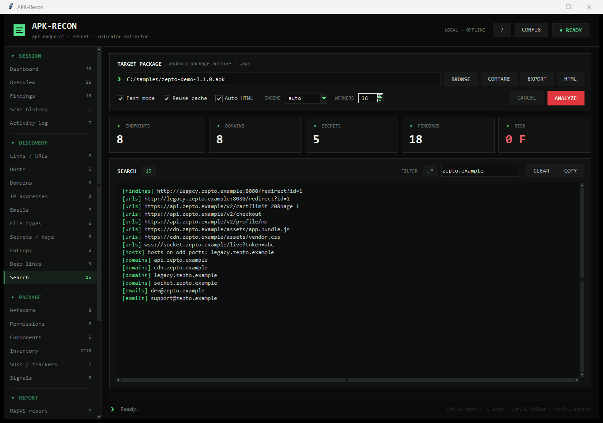

The filter box doubles as omni-search: every view is searched at once and results are tagged with
their source (`[urls]`, `[secrets]`, `[hosts]`…). Toggle `.*` for regex; invalid patterns fall back
safely.

---

### PACKAGE

#### Metadata


Package identity, version, SDK levels, SHA-256, plus manifest security flags (debuggable, backup,
cleartext, testOnly, network config) and signing details: v1/v2/v3 schemes, certificate subject,
issuer, SHA-256 and expiry.

#### Permissions


Permissions sorted by risk first. Dangerous entries carry a colour-coded risk tag and a plain
description (`READ_SMS · reads SMS`). The risk mapping feeds both findings and MASVS.

#### Components
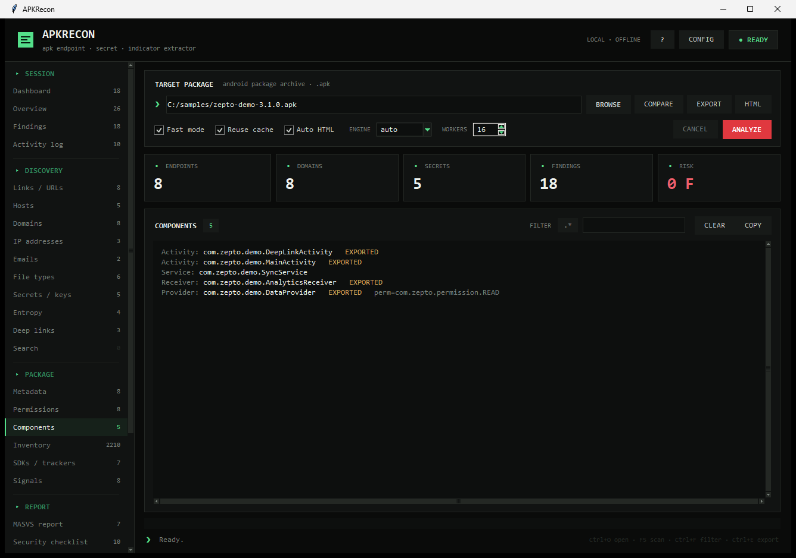

Activities, services, receivers and providers with `EXPORTED` markers and declared permissions.
Exported receivers/providers raise the severity of the exported-components finding.

#### Inventory
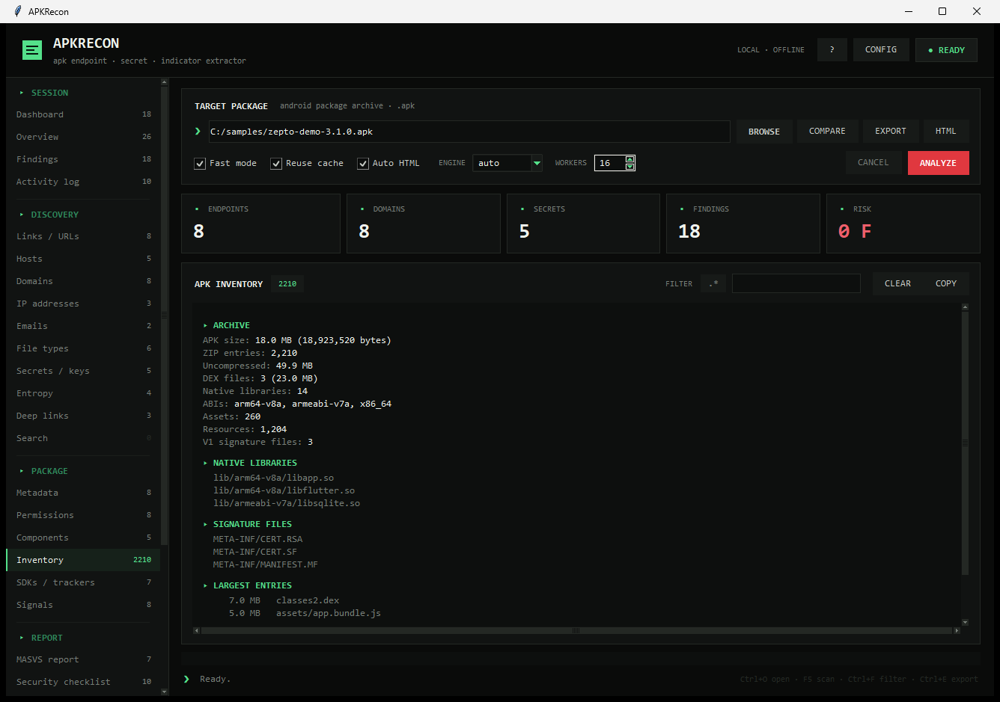

Archive-level facts read straight from the zip central directory — works without androguard:
APK size, entry count, uncompressed size, DEX count/size, native library count and ABIs, assets,
resources, v1 signature files, sample `.so` paths and the largest entries.

#### SDKs / trackers
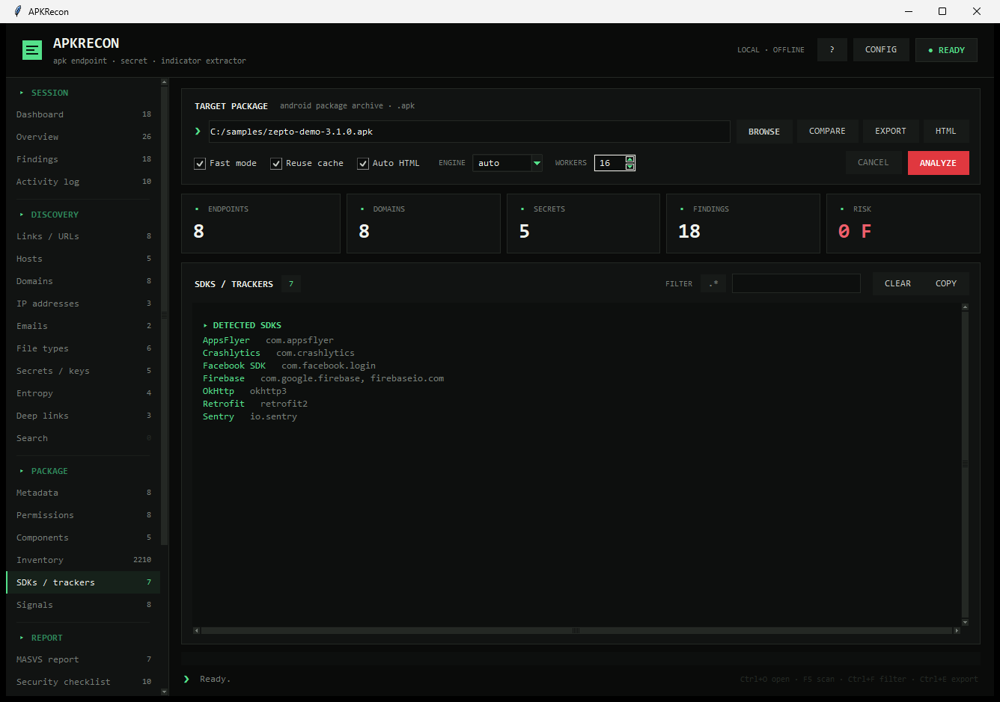

Third-party SDK fingerprints detected by a single combined marker pass: Firebase, Crashlytics,
Facebook, AppsFlyer, Adjust, Sentry, OneSignal, Braze, Segment, Unity, Flutter, React Native,
Stripe, OkHttp, Retrofit and more. Each entry lists the markers that matched.

#### Signals


Cryptographic markers (AES/ECB, DES/3DES, RC4, MD5, SHA-1 counts) and platform signals
(certificate pinning, root detection, attestation, biometrics, WebView bridges, dynamic code
loading, reflection, native loading). The reference patterns are listed at the bottom.

---

### REPORT

#### MASVS report
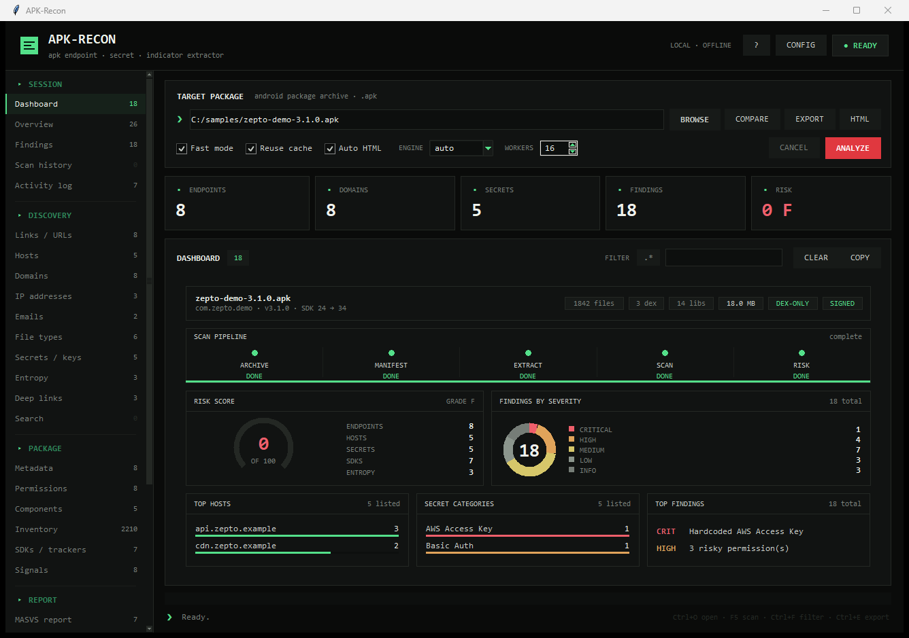

All eight OWASP MASVS categories — STORAGE, CRYPTO, AUTH, NETWORK, PLATFORM, CODE, RESILIENCE,
PRIVACY — each with a status badge, evidence bullets and clickable MASVS / MASTG links. Status is
derived from findings, manifest flags, signing data and signals (see *Techniques*).

#### Security checklist
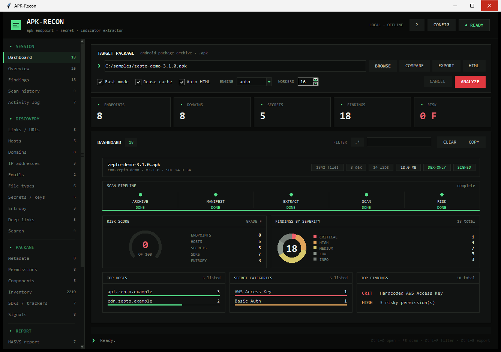

A compact PASS/REVIEW list: secrets, cleartext endpoints, deep-link surface, scan coverage, target
SDK, dangerous permissions, debug flag, backup posture, exported components and signature scheme.

#### Baseline diff
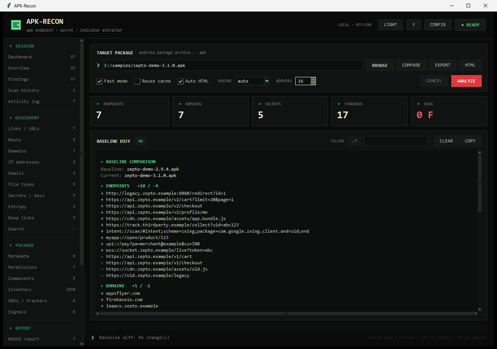

Choose a previous JSON export and see exactly what changed: `+` additions in green, `-` removals
in red, across endpoints, domains, permissions, components, SDKs and secrets, plus a metadata
change table. Diff state persists while you keep browsing other views.

---

### REFERENCE

#### Cheat sheet
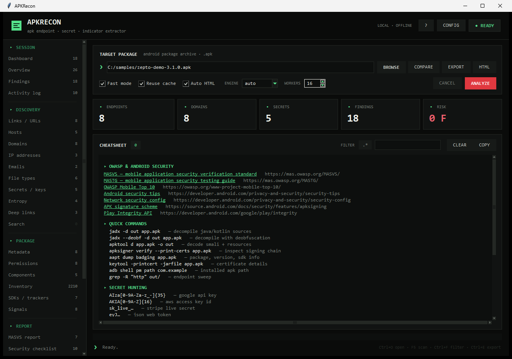

Clickable OWASP/Android references, ready-to-copy commands (jadx, apktool, apksigner, aapt,
keytool, adb), secret-hunting patterns, the severity model and a suggested workflow. Press `F1` for
the how-to dialog from anywhere.

#### Environment
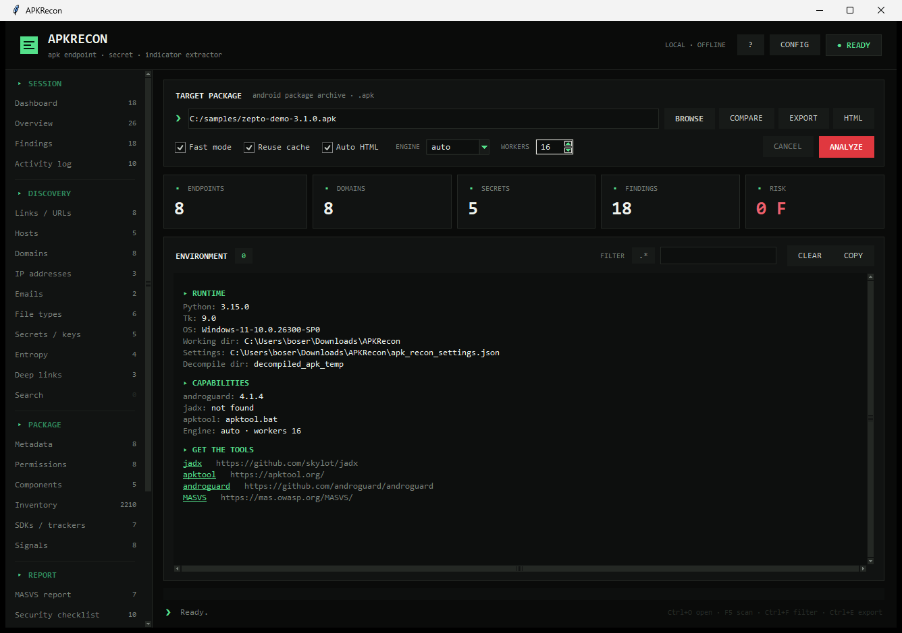

Python/Tk/OS versions, working directory, settings path, decompile cache path, androguard version,
detected jadx/apktool paths, current engine and worker defaults, plus install links.

---

### Dialogs

#### Scan setup (after Analyze)
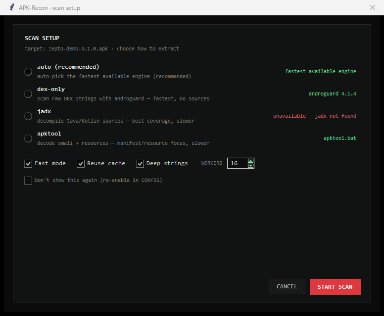

Shown before every scan unless disabled. Each engine lists its description and live availability
(androguard version, jadx/apktool detection, custom paths from CONFIG). The selected setup is
applied to the run and persisted; "Don't show this again" can be reversed in CONFIG.

#### How to use (`?` / `F1`)
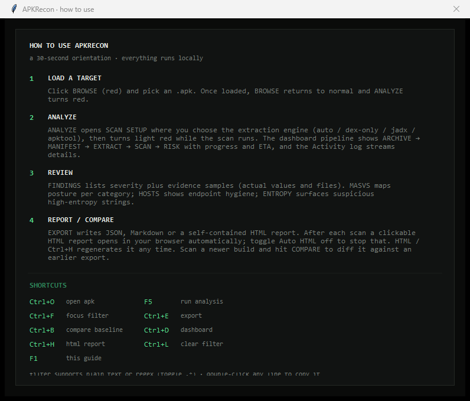

A 30-second orientation with the four-step workflow, button-state explanation, shortcut grid and a
link to the cheat sheet.

#### Configuration (`CONFIG`)
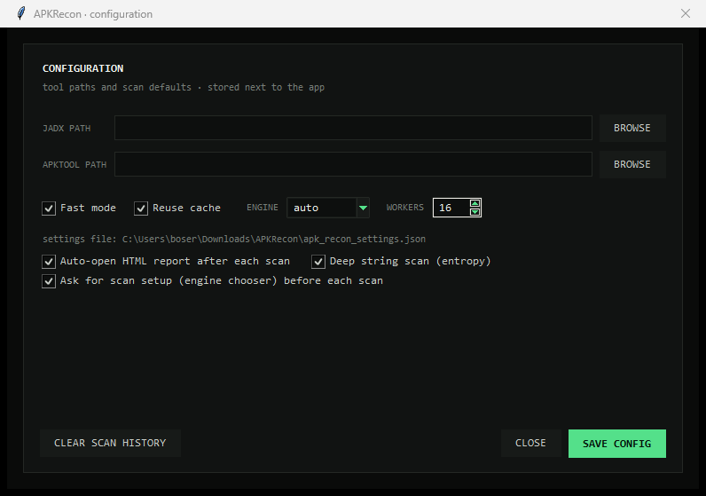

Optional jadx/apktool path overrides, engine, workers, fast mode, cache reuse and the
**Auto-open HTML report** toggle. Saved to `apk_recon_settings.json` next to the script.

---

### HTML report

After each successful scan — when *Auto HTML* is enabled — APK-Recon writes
`reports/<apk>-<timestamp>.html` and opens it in your default browser. The `HTML` button and
`Ctrl+H` regenerate it on demand.

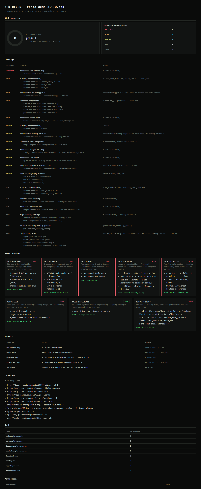

The report is a single self-contained file (no network requests) with a CSS risk ring, severity
distribution, findings + evidence, MASVS cards with links, secrets, endpoints, hosts, permissions,
SDKs, inventory and metadata. Use it as the engagement artefact.

---

## Techniques under the hood

### Scan setup and deep strings
Before a scan, `ask_scan_setup()` detects available engines (`androguard` version, jadx/apktool
paths including CONFIG overrides), recommends one, and applies fast mode, cache reuse, entropy
("deep strings") and worker count. The result is persisted in `apk_recon_settings.json`.
`scan_text(..., deep=False)` skips the entropy pass for a faster scan, which matters on large DEX
blobs.

### Scan history
`_record_history()` stores one compact record per successful scan in `apk_recon_history.json`
(capped at 100 entries) and refreshes the History view; `Clear scan history` lives in CONFIG.

### Scan pipeline
`_worker()` runs five phases and updates the dashboard through a thread-safe `after()` bridge:
inventory (zip), manifest/signing (androguard), extract (DEX or decompile), scan (parallel regex
pass), risk (finding + score computation). ETA is `elapsed / fraction - elapsed`, recomputed on
each progress update.

### Extraction catalog
All patterns live in one place in `main.py`:

| Group | What is matched |
| --- | --- |
| URL schemes | http(s), ftp(s), ws(s), file, content, android, intent, market, mailto, tel, sms, geo, whatsapp, slack, oauth, chrome, app, custom schemes… |
| Domains | common TLDs (com, io, app, dev, cloud, ai, …) |
| IPs | IPv4 and IPv6 literals |
| Emails | RFC-ish address pattern |
| Extensions | archives, configs, media, certs, code, db, native |
| Secrets | ~40 categories: AWS, GCP, Azure, Stripe, PayPal, JWT, Bearer/Basic, Slack, Discord, Telegram, Twilio, SendGrid, Mailgun, GitHub, GitLab, npm, PyPI, wallets, private keys, mnemonics, Firebase/S3/GCS, Mapbox, Facebook, generic passwords/API keys |
| Deep links | any scheme not classified as web transport |

### Secret severity matrix
Each category maps to a severity (`SECRET_SEVERITY`): live cloud keys, private keys, live Stripe
keys, mnemonics and GitHub/GitLab tokens are CRITICAL; webhooks, bot tokens and AWS/Azure secrets
are HIGH; API keys, JWTs, weak hints are MEDIUM; wallet addresses and IDs are LOW.

### Risk score
Start at **100**, subtract weights, floor at 0:

| Severity | Weight |
| --- | --- |
| CRITICAL | 28 |
| HIGH | 14 |
| MEDIUM | 6 |
| LOW | 2 |
| INFO | 0 |

Secret findings are capped at 45 penalty, permission findings at 25, all other findings are
uncapped. Grades: **A ≥ 90, B ≥ 75, C ≥ 60, D ≥ 40, F < 40**.

### Entropy
`shannon_entropy()` over tokens from `[A-Za-z0-9+/=_-]{24,}`; requires digit + alpha, ≥ 8 unique
characters and entropy ≥ 4.3; at most 250 candidates per file; global dedupe across the scan.

### SDK, crypto and signal fingerprints
One combined, case-insensitive regex alternation per family (fast single pass per file). Matched
literals map back to a human SDK/signal name and counts are merged across files.

### MASVS mapping
Each category has explicit rules:

- **STORAGE** — HIGH/CRITICAL secrets, `allowBackup`
- **CRYPTO** — weak crypto markers
- **AUTH** — hardcoded passwords, basic/bearer/JWT, private keys
- **NETWORK** — cleartext endpoints or flag, network config, pinning references
- **PLATFORM** — exported components, deep links, WebView bridges
- **CODE** — debuggable/testOnly/target SDK, dynamic class loading
- **RESILIENCE** — debug/expired cert, missing v2/v3, root-detection references
- **PRIVACY** — tracking SDKs, sensitive permissions, embedded emails

### Host & URL analysis
`urlsplit()` per endpoint; hosts aggregated with scheme sets and path sets; query parameter names
counted with `parse_qsl()`; path prefixes = first two path segments; hygiene checks for
`http://`, IP literals, ports other than 80/443, and punycode (`xn--`).

### Manifest & signing
Via androguard: `<application>` flags (`debuggable`, `allowBackup`, `usesCleartextTraffic`,
`testOnly`, `networkSecurityConfig`) and component export rules (`exported` attribute, or presence
of an intent-filter excluding providers). Certificates give subject/issuer/SHA-256/expiry; a
subject containing “Android Debug” marks a debug signing key. Wrapped in defensive try/except so
version differences never break a scan.

### Inventory
`zipfile` central directory only — no extraction: counts/sizes for DEX, `.so` (with ABI from
`lib/<abi>/`), assets, resources, `META-INF` signature files, plus the eight largest entries.

### Baseline diff
Loads a previous JSON export and compares sets for URLs, domains, permissions, components, SDKs,
secret `(type, value)` pairs and metadata fields. Renders a `+`/`-` plan with a change total in the
sidebar.

### Reports
One HTML builder feeds both the saved report and the auto-open path (`webbrowser.open` on a
`file://` URI). Markdown mirrors the same sections; JSON is the machine-readable baseline format;
CSV is category/value/file; TXT is the raw grouped lists.

---

## Keyboard shortcuts

| Shortcut | Action |
| --- | --- |
| `Ctrl+O` | open APK |
| `F5` | run analysis |
| `Ctrl+F` | focus filter |
| `Ctrl+E` | export |
| `Ctrl+B` | compare baseline |
| `Ctrl+D` | dashboard |
| `Ctrl+H` | HTML report |
| `Ctrl+L` | clear filter |
| `F1` | how-to guide |

Double-click any result line to copy it. `COPY` in the results header copies the visible view
(dashboard copies a risk/findings summary).

---

## Output formats

| Format | Contents |
| --- | --- |
| HTML | styled, self-contained report (risk ring, findings + evidence, MASVS, inventory) |
| Markdown | same report as tables/lists, good for tickets and PRs |
| JSON | full machine-readable result — also the baseline for diffs |
| CSV | category / value / file rows |
| TXT | raw grouped lists |

Auto HTML files land in `reports/` beside `main.py` as `<apk>-YYYYMMDD-HHMMSS.html`.

---

## Configuration

Saved to `apk_recon_settings.json` next to the script:

- engine (`auto`, `dex-only`, `jadx`, `apktool`)
- fast mode, reuse decompiled cache, worker count
- jadx / apktool path overrides
- auto-open HTML report
- last used directory

The decompiled output cache lives in `decompiled_apk_temp/` with an engine marker so reuse is
safe across runs.

---

## Project layout

`main.py` is a ~20-line launcher; the application is split into focused modules:

```
main.py                        launcher (Tk root + APKReconGUI)
apkrecon/
  config.py                    palette, severity model, catalogs, paths
  regexes.py                   endpoint / secret / fingerprint patterns
  scanner.py                   ScanResult, extraction pass, inventory, helpers
  findings.py                  risk scoring + MASVS mapping
  androguard_support.py        optional androguard import
  templates_loader.py          template reader
  templates/report.css         HTML report stylesheet
  templates/report.html        HTML report shell
  ui/
    app.py                     composition, window, actions, diff, log
    theme.py                   widget factories
    scan.py                    scan orchestration + decompilers
    render.py                  ScanResult → per-view item lists
    dashboard.py               canvas charts + pipeline + phases
    textviews.py               text insertion, filtering, reference pages
    dialogs.py                 configuration, scan setup + how-to dialogs
    reports.py                 JSON / CSV / TXT / Markdown / HTML export
requirements.txt               optional dependencies (none required)
docs/ARCHITECTURE.md           module map, data flow, extension points
docs/screenshots/              screenshots used in this README
reports/                       generated HTML reports (created on demand)
decompiled_apk_temp/           cached decompilation output
apk_recon_settings.json        persisted preferences (created on first save)
apk_recon_history.json         local scan history (created after the first scan)
```

See [docs/ARCHITECTURE.md](docs/ARCHITECTURE.md) for the layering, threading model and how to add
new detectors, views, charts or exports.

---

## Limits & responsible use

- Static analysis only: obfuscated, packed or dynamically loaded payloads can hide data.
- Secrets are regex/heuristic leads — **verify before reporting or using them**.
- Entropy candidates are noisy by nature; treat them as leads.
- APK metadata, signing and manifest flags require `androguard`.
- Use APK-Recon only on applications you own or are authorised to assess. It makes no network calls
  and uploads nothing.
